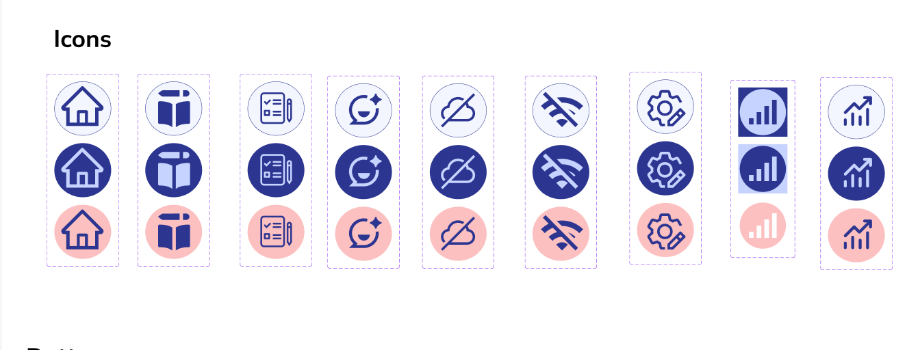
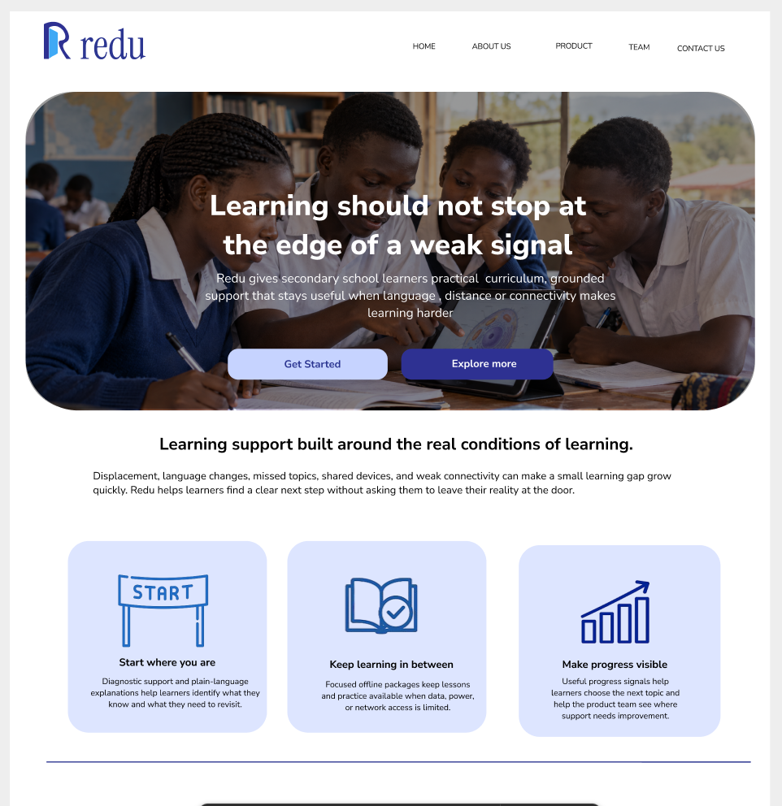
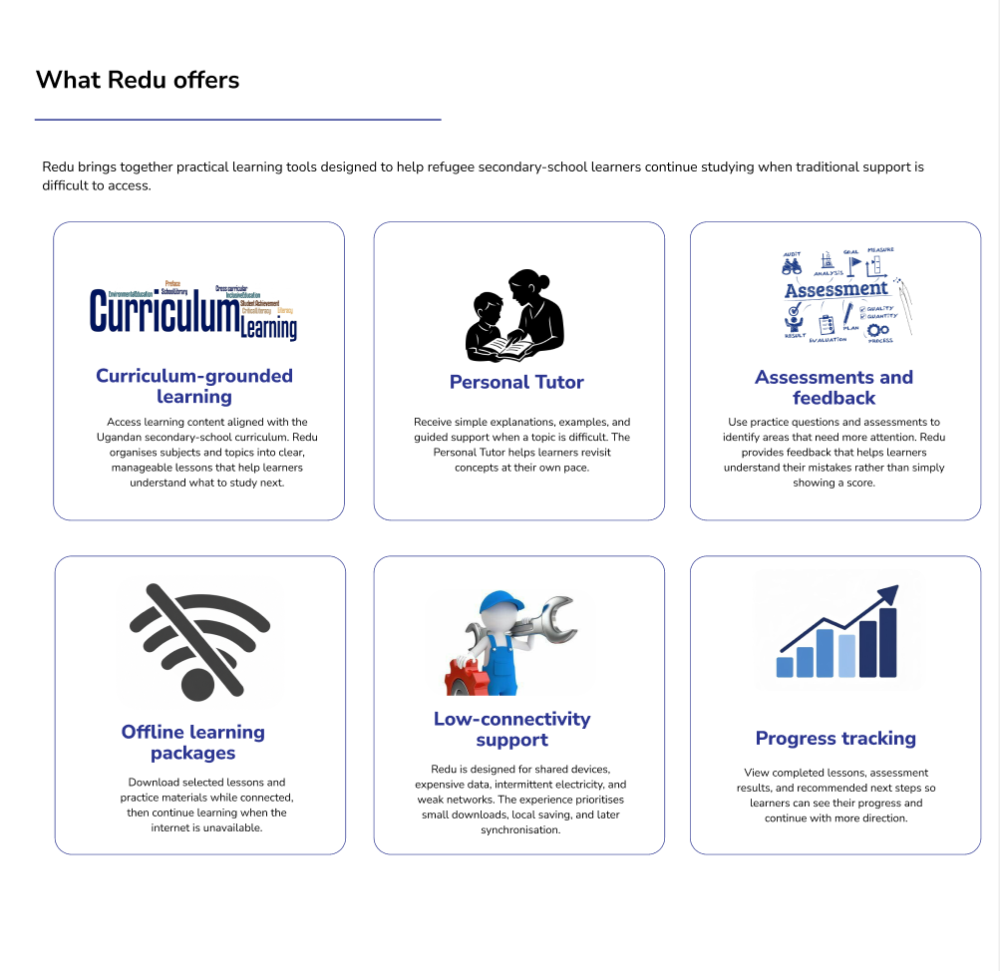

## 2. Brand Guidelines

### 2.1 Purpose

Redu’s brand guidelines ensure that the informational website and student PWA look and feel like one consistent product. The design should communicate trust, continuity and possibility while remaining clear and accessible for refugee secondary-school learners in Uganda.

Redu should feel:

- Supportive.
- Professional.
- Hopeful.
- Simple.
- Respectful, not pity-driven.

The central brand message is:

> **Learning that keeps going.**

### 2.2 Brand Positioning

Redu is an offline-first, curriculum-grounded learning platform for refugee secondary-school learners in Uganda. It provides structured lessons, practice, simpler explanations, progress support and AI-assisted tutoring when internet access or learning resources are limited.

Redu supports schools and learners; it does not replace teachers or national education systems.
### 2.3 Logo Inspiration and Development

The Redu logo is inspired by the image of an open door. The door represents access, opportunity and a pathway towards a better future through education.

For refugee secondary-school learners, education can be interrupted by displacement, language barriers, limited resources and unreliable connectivity. The open door symbol communicates that these challenges should not permanently close a learner’s educational journey. Redu is designed to help learners find a way forward and continue learning.

The logo represents:

- **Access:** making learning materials easier to reach.
- **Opportunity:** opening pathways to further education and future careers.
- **Progress:** helping learners move forward one lesson and topic at a time.
- **Welcome:** creating a learning space where learners feel supported.
- **Continuity:** keeping education open even when learning is interrupted.

The door also connects with Redu’s purpose as a bridge between the learner and educational support. Through curriculum-grounded lessons, practice, simpler explanations and offline access, Redu helps learners move through barriers that may otherwise limit their progress.

The logo was designed to be simple and recognisable across the informational website, student PWA, browser icon, offline packages, printed material and presentation documents. The blue communicates trust and stability, while the maroon accent adds warmth, confidence and distinction.

The final logo concept can be described as:

> **An open door to continued learning and future opportunity.**

### 2.4 Colour Palette

Redu uses deep blue, cool white and maroon to create a mature, calm and trustworthy visual identity.

| Colour | Hex value | Use |
|---|---|---|
| Redu Blue | `#17365D` | Headings, navigation and primary buttons |
| Deep Blue | `#0F2747` | Dark sections and hover states |
| Cool White | `#F7F9FC` | Main background |
| Pure White | `#FFFFFF` | Cards and content surfaces |

| Border Grey | `#D8E0EA` | Borders and dividers |

docs/assets/images/redu.png

### 2.5 Typography

Typography must remain readable on small smartphones, tablets and desktop screens. Use one primary sans-serif font across the website and PWA.

| Text level | Use |
|---|---|
| Display heading | Hero messages and major statements |
| Page heading | Main page and learning-area titles |
| Section heading | Separating content sections |
| Body text | Explanations and lesson content |
| Label | Forms and controls |
| Helper text | Additional guidance |
| Status text | Progress, offline and error messages |

Use clear headings, comfortable line spacing and sufficient space between lesson sections.

### 2.6 Buttons and Components

Buttons should describe the action clearly:

for the informational website

