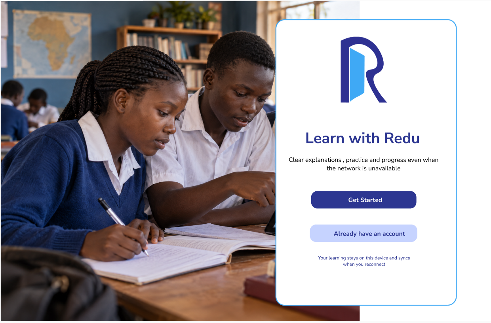
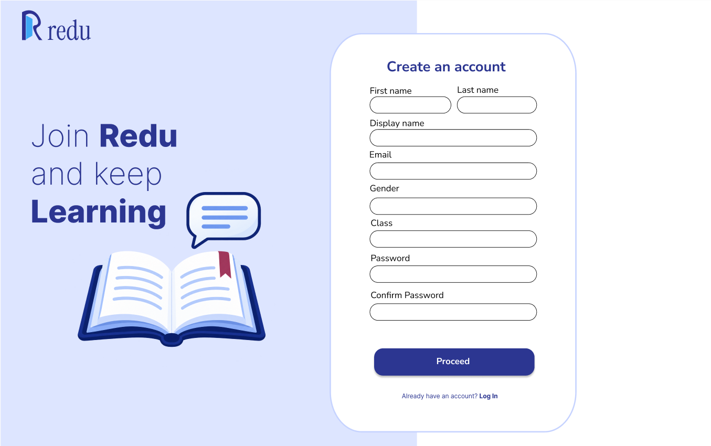
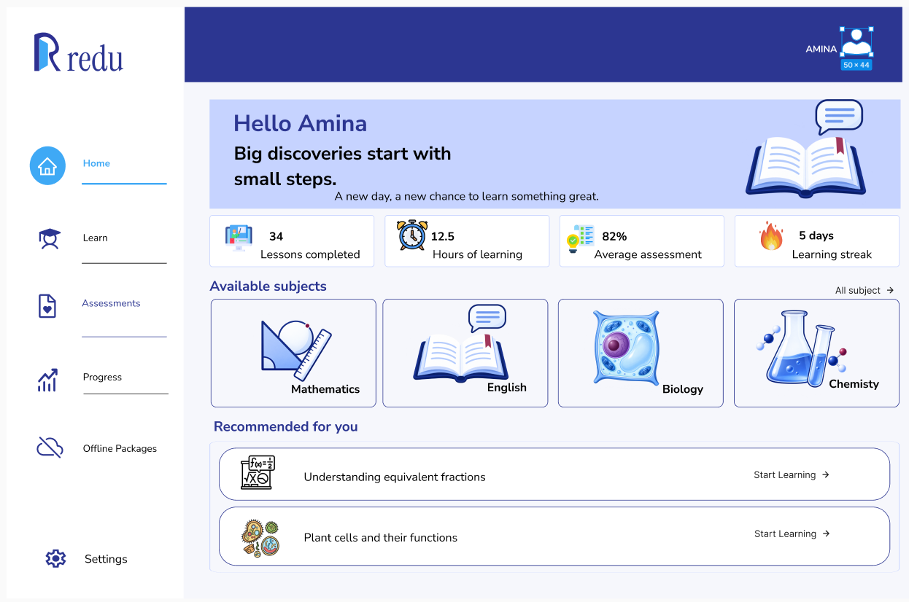

### Purpose

The Redu homepage introduces the platform to refugee learners, families, and NGO partners in Uganda. It explains the core product features and separates public information from the student learning application.

**Live link:** [Redu Informational Website](https://vercel.app)

---

### Main Message

> **Learning that keeps going.**

Redu delivers curriculum-grounded lessons, simple explanations, and offline support for low-connectivity environments.

---

### Home Page Structure

#### 1. Hero & onboarding
Introduces the value proposition ("Learning should not stop at the edge of a weak signal") and provides direct onboarding links for students.

#### 2. Core pillars
*   **Curriculum-grounded:** Aligned with the Ugandan secondary-school curriculum (English and Sciences).
*   **Personal tutor:** Simplified, language-aware explanations for multilingual learners.
*   **Offline-first:** Lightweight downloads built for shared devices and expensive mobile data.
*   **Formative assessments:** Feedback focused on understanding mistakes rather than just scores.

#### 3. Team & contact
Introduces the Techsus development team and provides a contact form to capture NGO and educational partnerships.
